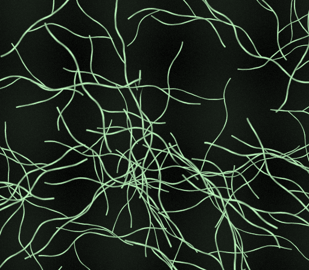
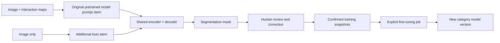
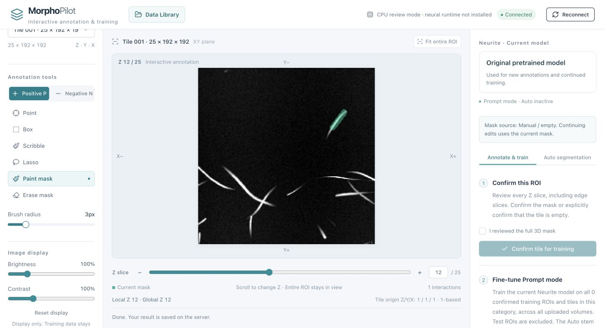

<p align="center"></p>

<h1 align="center">MorphoPilot</h1>
<p align="center"><strong>Teach the model. Reveal the structure.</strong><br>Open, self-hosted 3D annotation and iterative segmentation.</p>
<p align="center"><a href="https://morphopilot.github.io/">Website</a> · <a href="LICENSE">Apache-2.0 code</a> · <a href="docs/DEPLOYMENT.md">Install</a> · <a href="docs/USER_GUIDE.md">Use the studio</a> · <a href="website/README.md">Website source</a> · <a href="CONTRIBUTING.md">Contribute</a></p>

MorphoPilot turns a browser, a GPU server, and a few carefully reviewed image regions into a repeatable segmentation workflow. Upload a large 3D volume, divide it into manageable tiles, correct predictions with prompts, and train a model that belongs to your data category. Reassemble the saved masks in the coordinates of the original volume.

This repository provides a portable, open-source workflow for neurites, spots and other volumetric structures: no hosted-service account, OpenAI API key, private research dataset, or bundled checkpoint is required to inspect the code or try manual annotation.



*Public illustrations use generated synthetic structures, not patient data or measured model predictions.*

## Why this exists

Modern imaging can produce volumes much faster than a person can trace their contents. A useful annotation tool must connect expert corrections to model adaptation while keeping the original image, saved mask, review status, and model provenance understandable.

MorphoPilot brings those steps into one application. It is intended for research teams building microscopy and volumetric segmentation workflows. Neurites and fluorescent spots motivated the implementation; Cell, Organ, and custom categories provide separate workspaces, not claims of validated models for those domains.

## What works today

| Capability | What it does |
| --- | --- |
| Large-volume workflow | Resumable upload of single-channel ZYX TIFF, BigTIFF, NPY, or NPZ; default tiles of **25 Z × 192 Y × 192 X**, preserving edge extents. |
| Interactive annotation | Pretrained interactive inference from positive/negative points, boxes, scribbles, and lassos; direct brush/erase, undo, Z navigation, brightness, and contrast. |
| Iterative learning | Explicitly confirmed image–mask snapshots feed the next fine-tuning run; the new checkpoint becomes the current category model. |
| Independent categories | Neurite, Spot, Cell, Organ, and user-defined categories have separate annotations and model state. Images within a category contribute to its model. |
| Prompt → Auto | A separate image-only stem supports prompt-free inference after conversion and explicit Auto training. |
| Persistent library | Browse uploaded volumes, resume a tile, inspect global image/mask overlays, export merged masks, and remove or restore a volume. |
| Own-server deployment | React/Vite frontend, FastAPI gateway, Python workers, filesystem artifacts, and a local SQLite volume index. |

**The review step matters.** An inferred mask is not a verified label. Orange coverage indicates unreviewed regions; visible predicted foreground alone does not make a tile confirmed. Inspect all relevant slices before adding a mask to training.

## Quick start: no GPU or weights

Use **Node.js 22.13+ within v22, or v24+**, and **Python 3.10–3.12**. Linux is the target deployment platform. CPU mode lets you verify upload, tiling, manual annotation, persistence, and merging; it does not pretend to run neural inference.

From a clone or extracted source folder:

```bash
npm ci
npm run build
PYTHON_BIN=python3 bash deploy/install.sh cpu
.venv/bin/python deploy/configure.py --data-dir "$PWD/runtime"
.venv/bin/python examples/generate_synthetic.py --output-dir examples/generated
bash deploy/start.sh
```

Open **http://127.0.0.1:8787**, sign in with the workspace password you chose during configuration, and upload `examples/generated/neurites.tif`. Select **Neurite**, load a tile, paint a mask, review it, and confirm it. In Data Library, inspect the global overlay; use a **draft** export while tiles remain unreviewed, or review and confirm all four tiles before the final merge. The matching synthetic reference is for inspection only; it is not imported as an annotation. Ready-made public fixtures are also in [examples/fixtures](examples/fixtures/).

For Linux/CUDA installation, official weight download, HTTPS, systemd, backups, and troubleshooting, follow **[Deployment](docs/DEPLOYMENT.md)**. GPU operations have been exercised on an NVIDIA A100 40 GB in the predecessor application; smaller GPUs have not been qualified for every operation. Read the release-specific [validation record](docs/VALIDATION.md).

## How the model works



The Prompt path starts from the official pretrained segmentation weights: the original 8-channel input stem and network remain structurally intact. Prompt fine-tuning updates that path while the additional Auto stem is frozen and unused. Conversion copies the current prompt stem into the image-only stem, selecting the image channel of its first convolution. Auto training updates that stem and the shared network while freezing the prompt stem.

**Shared parameters are a real trade-off:** Auto training can change later Prompt predictions, and Prompt training after conversion invalidates Auto readiness. Conversion by itself is not evidence of good prompt-free segmentation. See [Architecture](docs/ARCHITECTURE.md) and [Evaluation](docs/EVALUATION.md).

The browser provides a web interface to the upstream interactive segmentation session. Native Prompt model exports retain the upstream format separately from the dual-stem checkpoint. See the [technical architecture](docs/ARCHITECTURE.md) and [upstream attribution](THIRD_PARTY_NOTICES.md).



*Actual browser screenshot from the standalone CPU installation. The green stroke is a manual edit on a generated synthetic image, not a model prediction.*

## A practical learning loop

1. Upload a volume to the right category and select a tile.
2. Put a positive point inside the desired structure. Add negative points only in clearly unwanted regions, taking nearby slices into account.
3. Review the full 3D mask, correct it, and explicitly confirm it.
4. Fine-tune Prompt on the accumulated confirmed samples in that category.
5. Test on another image or region excluded from training. Repeat only when the results justify it.
6. Convert and train Auto when reviewed masks are sufficient, then evaluate prompt-free outputs independently.

The application supports incremental experiments; it does not guarantee that more rounds increase accuracy. Synthetic examples demonstrate operation, not biological generalization. This source release does not publish the private ten-round research dataset or its derived weights.

## Explore and contribute

| Start here | Purpose |
| --- | --- |
| [User guide](docs/USER_GUIDE.md) | Upload → tile → annotate → train → merge. |
| [Deployment](docs/DEPLOYMENT.md) | CPU/GPU setup, model download, server operation. |
| [Architecture](docs/ARCHITECTURE.md) | Category isolation, model branches, state and data flow. |
| [Evaluation protocol](docs/EVALUATION.md) | Reproducible comparisons without training/test leakage. |
| [Agent deployment prompt](docs/AGENT_PROMPT.md) | A ready-to-use brief for Codex or another coding agent. |
| [Roadmap](docs/ROADMAP.md) | Current priorities and concrete contribution ideas. |
| [Validation](docs/VALIDATION.md) | What was actually checked, and what remains unverified. |
| [Project website](website/README.md) | Local preview and optional GitHub Pages deployment. |

```text
app/ + components/ + lib/   Browser annotation and data library
standalone/                Vite entry, authenticated gateway, worker supervisor
backend/                   Volume storage, inference, dual stem, training jobs
deploy/                    Environment, model, service, and backup tooling
examples/                  Reproducible synthetic volumes and references
tests/                     CPU and frontend regression checks
website/                   Public project introduction
docs/                      Deployment, architecture, evaluation, contributor context
```

Contributions that make a new lab's first successful installation easier are especially valuable. Read [CONTRIBUTING.md](CONTRIBUTING.md) and the [agent instructions](AGENTS.md). No OpenAI service is required to run the application; optional coding-agent workflows are development tools.

## License and credits

MorphoPilot-owned source, documentation, and generated synthetic examples are licensed under **[Apache-2.0](LICENSE)**. Third-party files retain their notices. The separately downloaded official pretrained **weights use CC BY-NC-SA 4.0**, which is distinct from the source-code license and restricts commercial use of those weights. Private research images and derived checkpoints are not included or licensed by this repository. See [Third-party notices](THIRD_PARTY_NOTICES.md).

Built on established interactive segmentation methods, PyTorch, FastAPI, React, and Vite. Upstream methods, dependencies and licenses are credited in [Third-party notices](THIRD_PARTY_NOTICES.md). Please cite the upstream methods as well as this software when appropriate; [CITATION.cff](CITATION.cff) provides project metadata.

Research software, under active development. It is not a clinically validated diagnostic system.
