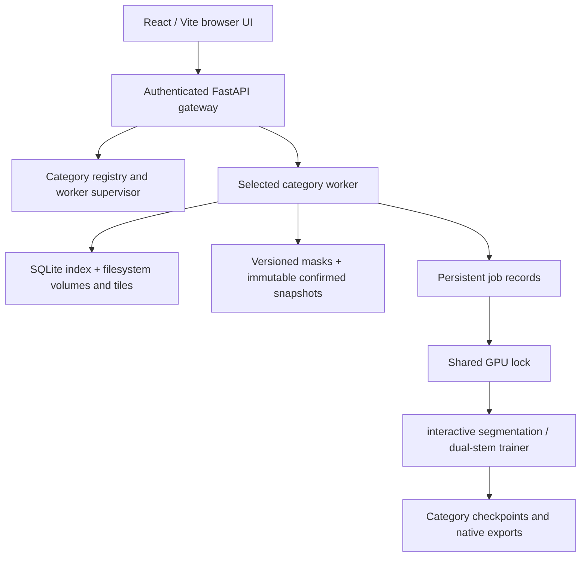

# Architecture

MorphoPilot keeps image storage and neural compute on the operator's server. The browser displays slices and sends explicit actions; it never receives a server credential or runs a fake substitute for neural inference.

## Request path

The standalone gateway serves the built browser files and proxies API calls to the category worker. Built-in categories have independent runtime roots. A registry and supervisor provision custom categories with fresh official-model state. All categories may use the same immutable official pretrained source, but trained checkpoints and confirmed data remain separate. GPU work is serialized across workers.

## Data lifecycle

1. An upload session receives chunks and validates the assembled single-channel volume.
2. The volume store indexes tiles with their source volume, origin, shape, and category. Default tile size is 25×192×192 in **ZYX** order. Boundary tiles keep their valid source extent.
3. Loading a tile reads its saved image and annotation state. Display brightness/contrast do not alter image values passed to training or inference.
4. Each edit advances the mask revision and records an event. Requests carrying an obsolete revision must fail rather than overwrite newer work.
5. Confirmation produces a snapshot used by a later explicit training job. A draft prediction is not sufficient for training eligibility.
6. A training job snapshots eligible confirmed records from the selected category, excluding records marked as test. It records its parent model, settings, progress, and output checkpoint.
7. Merging places saved tile masks back into source coordinates and records reviewed coverage. Missing or unreviewed coverage must remain distinguishable from confirmed background.
8. Volume removal uses the application's trash/restore mechanism; it must not silently rewrite unrelated category state or historical model provenance.

The volume index is local SQLite. Image arrays, masks, sample metadata, snapshots, checkpoints, and jobs are filesystem artifacts beneath the configured runtime. Back up both the index and files consistently; copying only SQLite is not a complete backup.

## Prompt and Auto branches

The original interactive segmentation input consists of one image channel and seven interaction channels. The Prompt path preserves the pretrained architecture. The extra one-channel Auto stem feeds the shared encoder stages and decoder.

| Operation | Prompt stem | Auto stem | Shared encoder/decoder |
| --- | --- | --- | --- |
| Initial load | Official parameters | Initialized separately from image-channel weights; inactive | Official parameters |
| Prompt fine-tuning | Updated | Frozen and unused | Updated |
| Convert to dual mode | Unchanged | Copied from current Prompt stem, first convolution narrowed to image channel | Unchanged |
| Auto fine-tuning | Frozen | Updated | Updated |

Conversion does not train Auto. Its predictions must be evaluated before use. Because the body is shared, Auto training can change Prompt results even though the Prompt stem is frozen. Further Prompt training invalidates Auto readiness until conversion is repeated.

Training currently uses 32×192×192 patches, AdamW, Dice plus cross-entropy, and prompts simulated from confirmed masks. These training prompts are not the same record as a user's interactive click history. The normal exported Prompt model directory contains native interactive segmentation metadata and checkpoint structure; the dual-stem checkpoint stores the additional branch separately.

## Failure and concurrency semantics

- Only one GPU operation enters the shared compute section at a time.
- A mask revision protects concurrent annotation requests; a busy worker rejects conflicting mutations.
- Cancellation and interrupted jobs should finish with explicit terminal state and leave prior usable models intact.
- Snapshot and model provenance are preserved so a visible mask is not confused with a fresh prediction from the current model.
- The gateway is a shared-login deployment, not a multi-tenant permission system. Per-user roles and project access control are future work.

## Extension points

- `backend/model.py`, `model_build.py`, and `train.py`: model adapter and optimizer workflow.
- `backend/volume_store.py` and `volume_trash.py`: volume formats, tiling, reconstruction, and storage lifecycle.
- `backend/category_registry.py` and `standalone/category_manager.py`: category provisioning and process state.
- `app/studio.tsx`, `components/`, and `lib/`: annotation interaction, library views, upload and UI state.

Keep format, checkpoint, and training-policy changes explicit. A new application category is isolated storage/model state; it is not by itself a specialized pretrained model.
